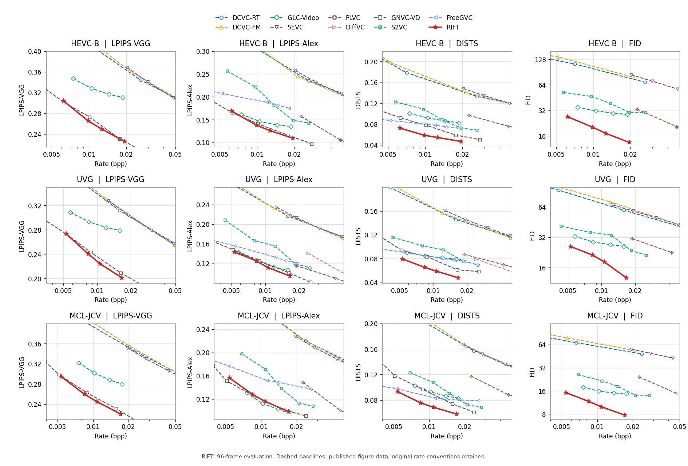

<div align="center">

# RIFT
### Residual-Informed Flow Transfer for One-Step Generative Video Compression

**Learned latent compression · residual-informed restoration · one DiT forward per GOP**

[](pyproject.toml)
[](requirements-lock.txt)
[](docs/FRAMEWORK.md)
[](docs/benchmarks/DATASET_METRICS.csv)

[Overview](#overview) · [Interactive comparisons](#interactive-comparisons) · [Benchmarks](#benchmarks) · [Quick start](#quick-start) · [Documentation](#documentation)

**English** | [简体中文](README.zh-CN.md)

[**Drag to compare Original / GLC / RIFT →**](https://qzwamg-web.github.io/RIFT-RESIDUAL-INFORMED-FLOW-TRANSFER-FOR-ONE-STEP-GENERATIVE-VIDEO-COMPRESSION/comparisons/)

</div>


<p align="center"><em>Native1080p MCL-JCV examples. Each method uses its own lowest-rate operating point; starred baseline rates are entropy estimates. These are not matched-bitrate comparisons.</em></p>

## Overview

RIFT combines an entropy-coded latent video representation with a pretrained video flow model. Decoder-visible compression information conditions a **single whole-GOP DiT forward**. Residual strength, direction and gain modules produce a correction to the decoded latent before VAE reconstruction.

This repository provides the research implementation of RIFT, including latent entropy coding, one-step restoration, training, evaluation and interactive visual comparisons.

- **One-step restoration:** one pretrained Wan DiT call per latent GOP, without random-noise sampling or iterative denoising.
- **Residual-informed transfer:** codec/QP information, full-band residual strength and direction/gain adaptation.
- **Actual latent coding:** learned I/P transforms, regional quantization and rANS payload accounting.
- **Shared restoration pipeline:** training and inference use the same restoration code and conditioning adapters.


The final latent has the form

$$\hat z = z_q + a\,d,$$

where $z_q$ is the decoded codec latent, $d$ is the adapted channel direction, and $a$ is the calibrated update magnitude.

| Codec QP | 0 | 16 | 39 | 63 |
|---|---:|---:|---:|---:|
| Wan time | 520 | 640 | 800 | 960 |

[Framework details](docs/FRAMEWORK.md) · [Quantization](docs/CODEC_QUANTIZATION.md)

## Interactive comparisons

**[Open the interactive viewer →](https://qzwamg-web.github.io/RIFT-RESIDUAL-INFORMED-FLOW-TRANSFER-FOR-ONE-STEP-GENERATIVE-VIDEO-COMPRESSION/comparisons/)**

Click a scene below, then drag the two dividers to compare **Original / GLC / RIFT**. Switch to **GLC / RIFT**, view the full frame or shared detail crop, and open lossless 1080p images. Mouse, touch and keyboard controls are supported. The README previews are static; the sliders run on the linked GitHub Pages site.

<table>
<tr>
<td width="50%" align="center">
<a href="https://qzwamg-web.github.io/RIFT-RESIDUAL-INFORMED-FLOW-TRANSFER-FOR-ONE-STEP-GENERATIVE-VIDEO-COMPRESSION/comparisons/#bosphorus"></a><br>
<strong>Bosphorus</strong> · UVG · Frame 66<br>
<sub>Original / GLC / RIFT · Click to drag</sub>
</td>
<td width="50%" align="center">
<a href="https://qzwamg-web.github.io/RIFT-RESIDUAL-INFORMED-FLOW-TRANSFER-FOR-ONE-STEP-GENERATIVE-VIDEO-COMPRESSION/comparisons/#mcl12"></a><br>
<strong>City skyline</strong> · MCL-JCV · Frame 41<br>
<sub>Original / GLC / RIFT · Click to drag</sub>
</td>
</tr>
<tr>
<td width="50%" align="center">
<a href="https://qzwamg-web.github.io/RIFT-RESIDUAL-INFORMED-FLOW-TRANSFER-FOR-ONE-STEP-GENERATIVE-VIDEO-COMPRESSION/comparisons/#mcl03"></a><br>
<strong>Gilded interior</strong> · MCL-JCV · Frame 89<br>
<sub>Original / GLC / RIFT · Click to drag</sub>
</td>
<td width="50%" align="center">
<a href="https://qzwamg-web.github.io/RIFT-RESIDUAL-INFORMED-FLOW-TRANSFER-FOR-ONE-STEP-GENERATIVE-VIDEO-COMPRESSION/comparisons/#bqterrace"></a><br>
<strong>BQTerrace</strong> · HEVC-B · Frame 0<br>
<sub>Original / GLC / RIFT · Click to drag</sub>
</td>
</tr>
</table>

The gallery presents four qualitative examples. Each method uses its own lowest-rate point; GLC rates are entropy estimates and RIFT rates are actual rANS payload rates. [Source, frame and crop metadata](docs/comparisons/PROVENANCE.json).

<details>
<summary><strong>Original paper comparison panel</strong></summary>


The original sequence-bpp and displayed-frame LPIPS labels are retained. Each method uses its own lowest-rate point; starred rates are entropy estimates. The panel illustrates visual behavior rather than equal-rate performance.

</details>

## Benchmarks



**Solid red curves show RIFT results. Dashed baseline curves are digitized published references**, with their original rate and evaluation conventions. [Figure provenance](docs/benchmarks/README.md).

These **QP63** rows come from the released [dataset metrics CSV](docs/benchmarks/DATASET_METRICS.csv).

| Resolution | Dataset | Videos | Payload bpp | PSNR ↑ | LPIPS-VGG ↓ | DISTS ↓ | Patch FID ↓ |
| --- | --- | ---: | ---: | ---: | ---: | ---: | ---: |
| 1080p | HEVC-B | 5 | 0.006201 | 26.1360 | 0.3042 | 0.0725 | 26.9219 |
| 1080p | UVG | 7 | 0.005290 | 28.9444 | 0.2734 | 0.0792 | 25.9373 |
| 1080p | MCL-JCV | 30 | 0.005376 | 28.0211 | 0.2946 | 0.0932 | 15.2820 |
| 720p | HEVC-B | 5 | 0.006745 | 25.6649 | 0.3039 | 0.0783 | 36.5654 |
| 720p | UVG | 7 | 0.005369 | 28.8629 | 0.2765 | 0.0867 | 35.2644 |
| 720p | MCL-JCV | 30 | 0.005886 | 27.3766 | 0.3048 | 0.1024 | 22.6745 |

The CSV contains **24 dataset/resolution/QP aggregates** covering **336 video/resolution/QP cases** across 42 videos.

<details>
<summary><strong>Evaluation protocol</strong></summary>

- HEVC-B: 5 videos; UVG: 7; MCL-JCV: 30; four QPs and 720p/1080p.
- Encode and score the first **96 genuine frames** in GOPs **25/25/25/21**; no repeated tail frames.
- 1080p: reflect-pad to 1920×1088 for coding, crop to 1920×1080 for scoring.
- 720p: center-crop original sources to 1280×736 for coding, then to 1280×720 for scoring; no resizing.
- Rate: actual rANS payload bits / (coded frames × coded-canvas pixels); container/header bytes are excluded.
- Float-domain spatial metrics and dataset-pooled dual-grid 256-patch FID.

See the [evaluation specification](docs/TESTING.md) for input geometry, rate accounting and metric aggregation.

</details>

## Quick start

### 1. Install

```bash
git clone https://github.com/qzwamg-web/RIFT-RESIDUAL-INFORMED-FLOW-TRANSFER-FOR-ONE-STEP-GENERATIVE-VIDEO-COMPRESSION.git
cd RIFT-RESIDUAL-INFORMED-FLOW-TRANSFER-FOR-ONE-STEP-GENERATIVE-VIDEO-COMPRESSION
conda create -n rift python=3.10 -y
conda activate rift
# Install a CUDA-compatible PyTorch / torchvision stack first.
python -m pip install -e ".[metrics]"
python -m pip install pybind11 ninja einops easydict safetensors \
  diffusers transformers tokenizers ftfy opencv-python-headless \
  torchmetrics torch-fidelity scipy av
(cd third_party/DCVC/src/cpp && python setup.py build_ext --inplace)
python scripts/final.py --help
```

`requirements-lock.txt` records the observed research environment, including CUDA-specific packages; adapt PyTorch wheels to your hardware. [Installation guide](docs/INSTALL.md).

### 2. Prepare model and data resources

Training and inference require the RIFT checkpoint, pretrained backbone, VAE, codec initializers and dataset indices. **Model weights are not included, and public download links are not yet available.** See [required resources](docs/ASSETS.md).

```bash
export RAQVC_ARTIFACTS=/path/to/resources
# Keep the supplied model/data bundle layout under this directory.
# Configure codec weight paths in configs/codec.yaml.
# The evaluation manifest uses paths relative to the repository.
ln -s /path/to/video_datasets data
python scripts/final.py preflight
```

The checkpoint contains trained codec, conditioning, restoration and LoRA parameters; its matching backbone and VAE are required.

### 3. Run

```bash
# Check the training pipeline and checkpoint save/reload.
python scripts/final.py smoke --devices 0 --output outputs/smoke

# Fine-tune RIFT; --batch is per GPU.
python scripts/final.py train --devices 0,1,2,3,4,5 \
  --steps 512 --batch 1 --evaluate-after \
  --output outputs/joint

# Resume with the same original training configuration.
python scripts/final.py resume --devices 0,1,2,3,4,5 \
  --steps 512 --batch 1 --evaluate-after \
  --output outputs/joint

# Resumable 42-video evaluation; separate runtime measurements.
python scripts/final.py evaluate --devices 0 --resolutions 720 1080 --output outputs/evaluation
python scripts/final.py speed --devices 0 --output outputs/speed
```

The reference 512-pixel training configuration requires approximately **75 GiB** of GPU memory. Run the smoke check before selecting a batch size. These commands fine-tune an existing checkpoint. See [training configuration](docs/TRAINING.md).

The connection-head ablation uses `scripts/train_headless.py` and `scripts/evaluate_headless.py` with its corresponding checkpoint format.

## Repository layout

```text
raqvc/
  backbone/       Wan DiT, VAE and decoder-side conditioning
  codec/          I/P transforms, regional quantization and entropy coding
  training/       Shared restoration endpoint, objectives and parameter groups
  data/           Video and 256/512 latent-cache loaders
  metrics/        Spatial, temporal and distributional perceptual metrics
scripts/final.py  preflight · smoke · train · resume · evaluate · speed
configs/          Codec configuration and 42-video evaluation manifest
docs/             Reproduction contracts, assets, benchmarks and interactive viewer
assets/           Original paper figures, visual comparisons and R–D figure
third_party/      Vendored DCVC/Wan sources with upstream notices
```

## Documentation

| Topic | Reference |
|---|---|
| Installation | [docs/INSTALL.md](docs/INSTALL.md) |
| Model and dataset assets | [docs/ASSETS.md](docs/ASSETS.md) |
| Architecture | [docs/FRAMEWORK.md](docs/FRAMEWORK.md) |
| Training and learning rates | [docs/TRAINING.md](docs/TRAINING.md) |
| Video and metric protocol | [docs/TESTING.md](docs/TESTING.md) |
| Interactive viewer | [Live comparison gallery](https://qzwamg-web.github.io/RIFT-RESIDUAL-INFORMED-FLOW-TRANSFER-FOR-ONE-STEP-GENERATIVE-VIDEO-COMPRESSION/comparisons/) · [Source](docs/comparisons/README.md) |
| Benchmark provenance | [docs/benchmarks/README.md](docs/benchmarks/README.md) |
| Quantization | [docs/CODEC_QUANTIZATION.md](docs/CODEC_QUANTIZATION.md) |
| Third-party attribution | [third_party/VERSIONS.md](third_party/VERSIONS.md) |

## Acknowledgments and licensing

RIFT uses components from DCVC and Wan2.2. Their licenses and notices are included in [third_party](third_party/VERSIONS.md). Package licensing information is specified in [pyproject.toml](pyproject.toml).

[Report an issue](https://github.com/qzwamg-web/RIFT-RESIDUAL-INFORMED-FLOW-TRANSFER-FOR-ONE-STEP-GENERATIVE-VIDEO-COMPRESSION/issues).
