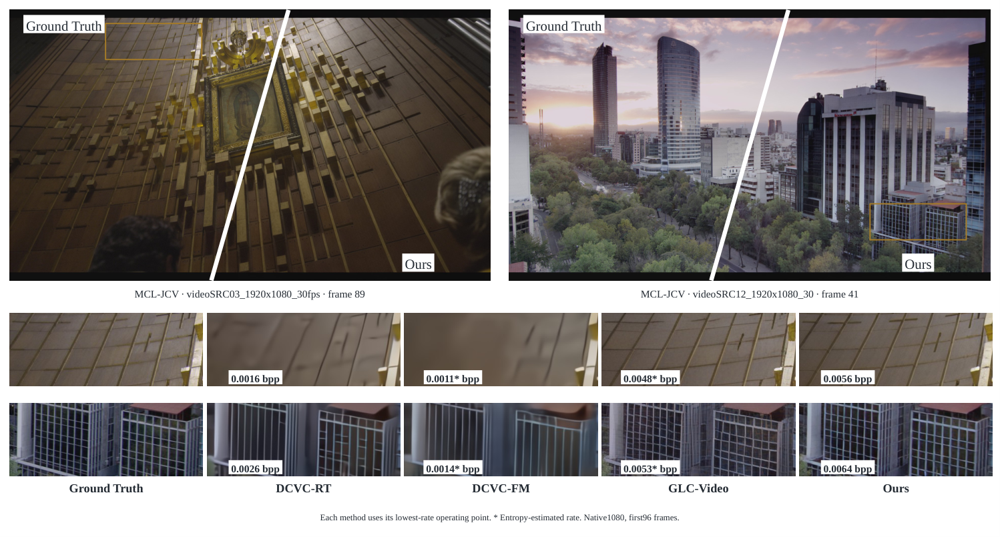
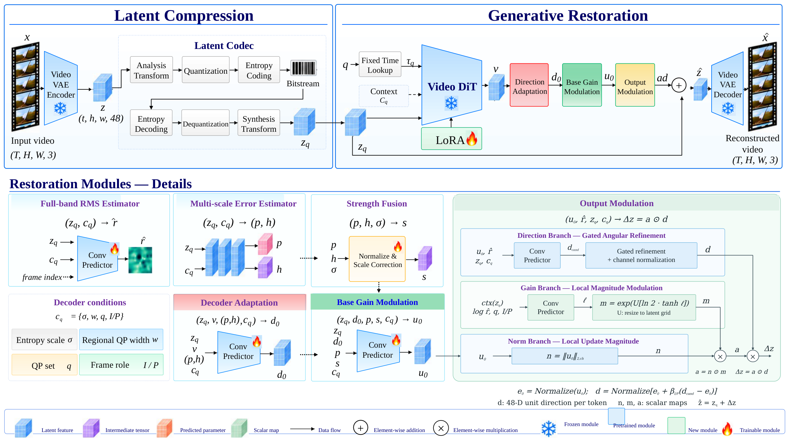
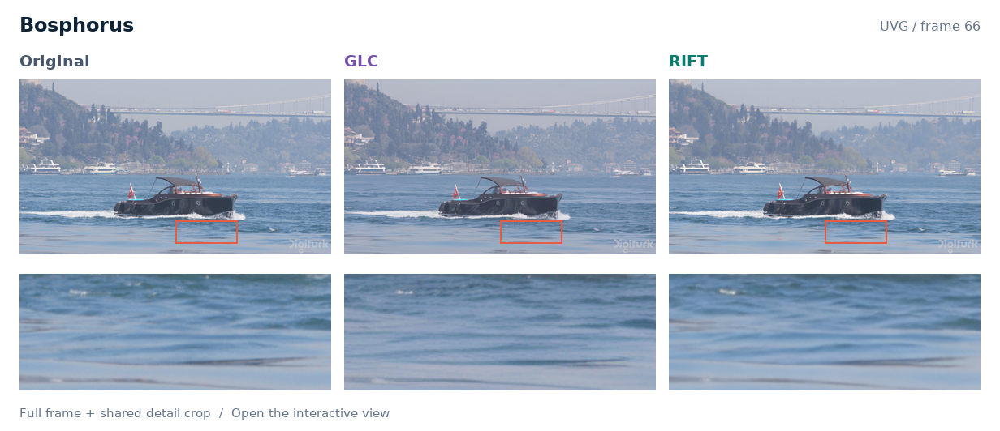
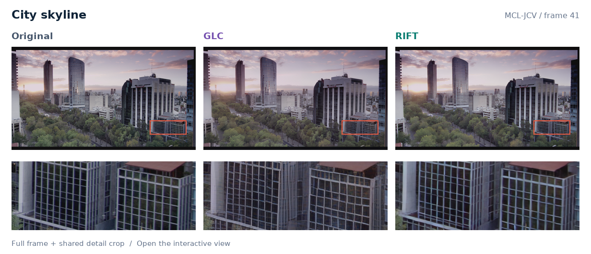
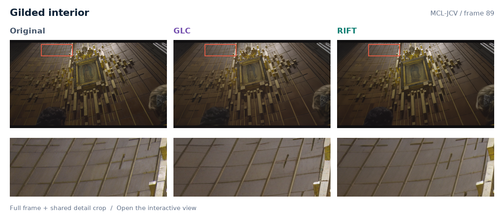
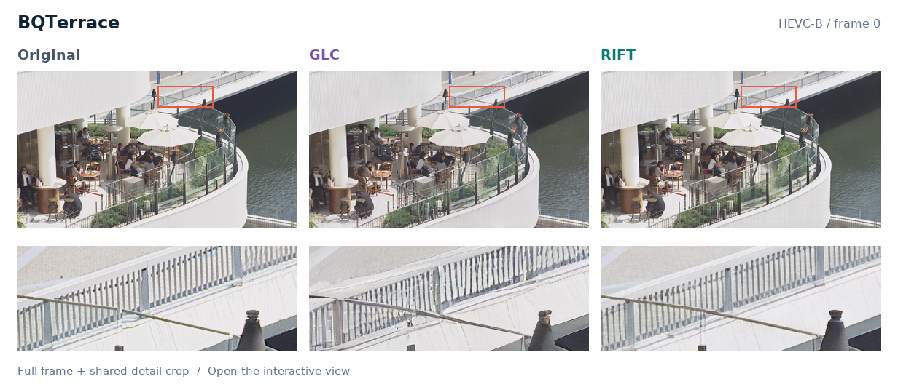
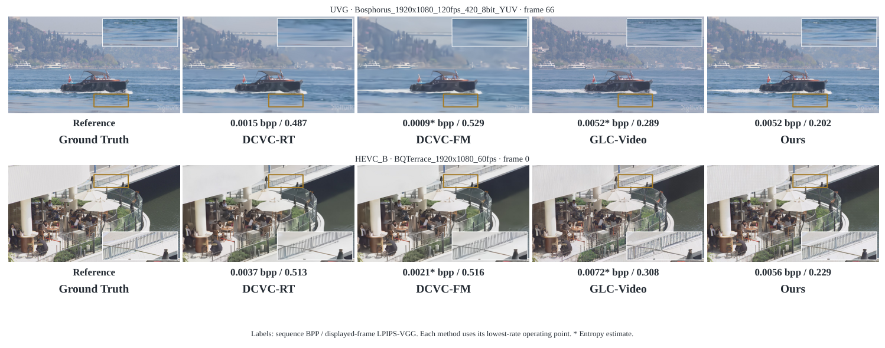
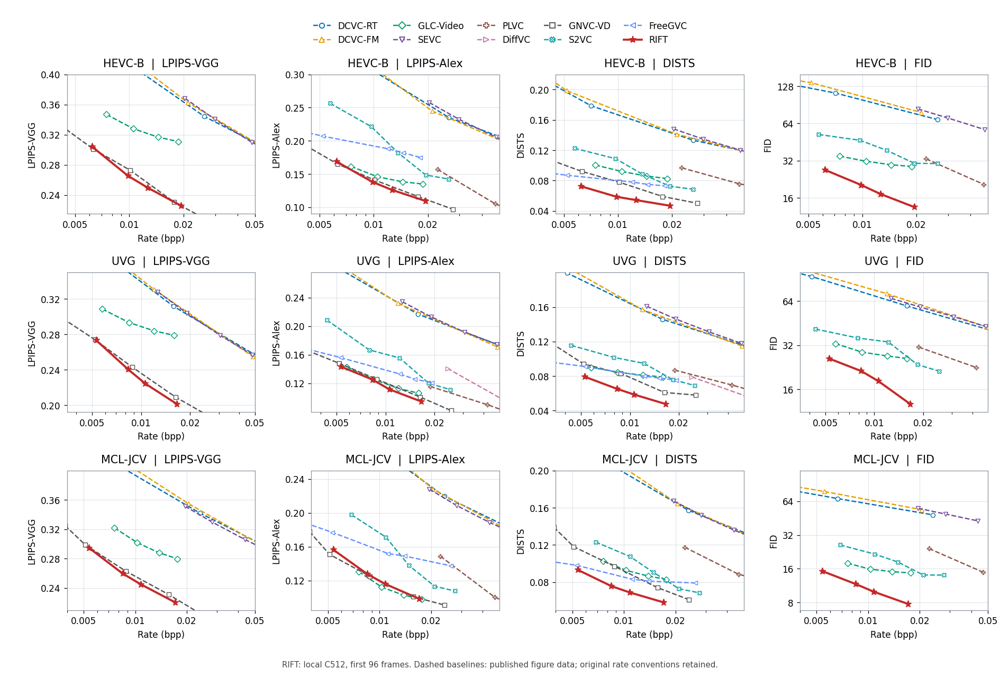

<div align="center">

# RIFT
### Residual-Informed Flow Transfer for One-Step Generative Video Compression

**残差信息引导的一步生成式视频压缩**

[](pyproject.toml)
[](requirements-lock.txt)
[](docs/FRAMEWORK.md)

[方法](#方法概览) · [交互对比](#交互对比) · [实验结果](#实验结果) · [快速开始](#快速开始) · [文档](#文档)

[English](README.md) | **简体中文**

[**拖动对比：原图 / GLC / RIFT →**](https://qzwamg-web.github.io/RIFT-RESIDUAL-INFORMED-FLOW-TRANSFER-FOR-ONE-STEP-GENERATIVE-VIDEO-COMPRESSION/comparisons/)

</div>



<p align="center"><em>原始 1080p MCL-JCV 展示图。各方法采用自身最低码率点，星号表示熵估计码率；图中不构成同码率比较。</em></p>

## 方法概览

RIFT 将可熵编码的视频 latent 表示与预训练视频流模型连接起来，利用解码端可获得的压缩信息，完成**每个 GOP 一次 DiT 前向**的生成式恢复。残差强度、方向和增益模块共同控制解码 latent 的修正，再经 VAE 重建视频。

本仓库发布 ICLR2027 RIFT 项目保留的 **C512 训练与推理端点**，以及独立的无连接头消融入口。

- **一步恢复**：固定 QP 时间表下，对整段 latent 进行一次 Wan 调用。
- **残差信息引导**：使用 codec/QP 条件、局部全频残差强度与方向、增益调制。
- **真实熵编解码**：I/P latent 变换、区域量化与 rANS payload 统计。
- **共享恢复端**：训练和推理使用同一实现，保留 C512 实际使用的继承适配器。



<p align="center">论文原始架构图 · <a href="assets/framework.pdf">PDF</a> · <a href="assets/framework.pptx">可编辑 PowerPoint</a></p>

最终 latent 的数学表达为：

$$\hat z = z_q + a\,d,$$

其中 $z_q$ 是 codec 解码的 latent，$d$ 是每个位置的通道单位方向，$a$ 是局部修正幅度。实际实现保留原有浮点运算顺序。

| Codec QP | 0 | 16 | 39 | 63 |
|---|---:|---:|---:|---:|
| Wan 时间 | 520 | 640 | 800 | 960 |

[框架细节](docs/FRAMEWORK.md) · [量化说明](docs/CODEC_QUANTIZATION.md)

## 交互对比

**[打开可拖动对比页 →](https://qzwamg-web.github.io/RIFT-RESIDUAL-INFORMED-FLOW-TRANSFER-FOR-ONE-STEP-GENERATIVE-VIDEO-COMPRESSION/comparisons/)**

点击下方任意样例，即可拖动两条分割线查看**原图 / GLC / RIFT**。支持切换 **GLC / RIFT** 双图对比、查看全帧或相同位置的细节裁剪，以及打开无损 1080p 图片。鼠标、手机触摸和键盘均可操作。README 内为静态预览，实际拖动控件运行在链接的 GitHub Pages 页面中。

<table>
<tr>
<td width="50%" align="center">
<a href="https://qzwamg-web.github.io/RIFT-RESIDUAL-INFORMED-FLOW-TRANSFER-FOR-ONE-STEP-GENERATIVE-VIDEO-COMPRESSION/comparisons/#bosphorus"></a><br>
<strong>Bosphorus</strong> · UVG · Frame 66<br>
<sub>Original / GLC / RIFT · 点击打开拖动对比</sub>
</td>
<td width="50%" align="center">
<a href="https://qzwamg-web.github.io/RIFT-RESIDUAL-INFORMED-FLOW-TRANSFER-FOR-ONE-STEP-GENERATIVE-VIDEO-COMPRESSION/comparisons/#mcl12"></a><br>
<strong>City skyline</strong> · MCL-JCV · Frame 41<br>
<sub>Original / GLC / RIFT · 点击打开拖动对比</sub>
</td>
</tr>
<tr>
<td width="50%" align="center">
<a href="https://qzwamg-web.github.io/RIFT-RESIDUAL-INFORMED-FLOW-TRANSFER-FOR-ONE-STEP-GENERATIVE-VIDEO-COMPRESSION/comparisons/#mcl03"></a><br>
<strong>Gilded interior</strong> · MCL-JCV · Frame 89<br>
<sub>Original / GLC / RIFT · 点击打开拖动对比</sub>
</td>
<td width="50%" align="center">
<a href="https://qzwamg-web.github.io/RIFT-RESIDUAL-INFORMED-FLOW-TRANSFER-FOR-ONE-STEP-GENERATIVE-VIDEO-COMPRESSION/comparisons/#bqterrace"></a><br>
<strong>BQTerrace</strong> · HEVC-B · Frame 0<br>
<sub>Original / GLC / RIFT · 点击打开拖动对比</sub>
</td>
</tr>
</table>

四组样例均复用 data 中的历史论文画面。各方法使用自身最低码率点；GLC 标注熵估计码率，RIFT 标注真实 rANS payload 码率。[来源、帧号与裁剪记录](docs/comparisons/PROVENANCE.json)。

<details>
<summary><strong>原始论文对比面板</strong></summary>



保留原图中的序列 bpp 和展示帧 LPIPS 标注。各方法使用自身最低码率点；星号码率为熵估计值。[素材来源与哈希](assets/PROVENANCE.json)。

</details>

## 实验结果



**红色实线为本地保留的 RIFT C512 测量，虚线基线为已发表论文的读图曲线。** 外部曲线保留各自原始码率及评测口径。[曲线来源](docs/benchmarks/README.md)。

以下为 **QP63** 的既有数据集汇总；[完整 CSV](docs/benchmarks/DATASET_METRICS.csv) 包含两种分辨率、三个数据集、四个 QP 的 24 行汇总，覆盖 336 个视频×分辨率×QP 结果。

| 分辨率 | 数据集 | 视频数 | Payload bpp | PSNR ↑ | LPIPS-VGG ↓ | DISTS ↓ | Patch FID ↓ | FloLPIPS ↓ |
|---|---|---:|---:|---:|---:|---:|---:|---:|---:|
| 1080p | HEVC-B | 5 | 0.006201 | 26.1360 | 0.3042 | 0.0725 | 26.9219 | 0.1810 |
| 1080p | UVG | 7 | 0.005290 | 28.9444 | 0.2734 | 0.0792 | 25.9373 | 0.1488 |
| 1080p | MCL-JCV | 30 | 0.005376 | 28.0211 | 0.2946 | 0.0932 | 15.2820 | 0.1637 |
| 720p | HEVC-B | 5 | 0.006745 | 25.6649 | 0.3039 | 0.0783 | 36.5654 | 0.1828 |
| 720p | UVG | 7 | 0.005369 | 28.8629 | 0.2765 | 0.0867 | 35.2644 | 0.1575 |
| 720p | MCL-JCV | 30 | 0.005886 | 27.3766 | 0.3048 | 0.1024 | 22.6745 | 0.1709 |

<details>
<summary><strong>C512 历史评测协议</strong></summary>

- HEVC-B / UVG / MCL-JCV 分别为 5 / 7 / 30 个视频。
- 编码并评分首 96 个真实帧，GOP 为 25 / 25 / 25 / 21，不复制尾帧。
- 1080p：反射补边至 1920×1088 编码，重建后裁回 1920×1080 评分。
- 720p：从原始视频中心裁出 1280×736 编码，再中心裁至 1280×720 评分，不缩放。
- 码率为实际 rANS payload 比特数除以编码帧数×编码画布像素；历史口径不计容器和 header。
- 空间指标使用浮点重建；FID 汇总数据集的双网格 256-patch 特征；FloLPIPS 覆盖 95 对相邻帧。

这些是保留的历史结果，本次 GitHub 发布没有重新运行 GPU 质量评测或完整 42 视频测试。[完整合同](docs/TESTING.md)。

</details>

## 快速开始

### 1. 安装

```bash
git clone https://github.com/qzwamg-web/RIFT-RESIDUAL-INFORMED-FLOW-TRANSFER-FOR-ONE-STEP-GENERATIVE-VIDEO-COMPRESSION.git
cd RIFT-RESIDUAL-INFORMED-FLOW-TRANSFER-FOR-ONE-STEP-GENERATIVE-VIDEO-COMPRESSION
conda create -n rift python=3.10 -y
conda activate rift
# 先安装与本机 CUDA 匹配的 PyTorch / torchvision。
python -m pip install -e ".[metrics]"
python -m pip install pybind11 ninja einops easydict safetensors \
  diffusers transformers tokenizers ftfy opencv-python-headless \
  torchmetrics torch-fidelity scipy av
(cd third_party/DCVC/src/cpp && python setup.py build_ext --inplace)
python scripts/final.py --help
```

`requirements-lock.txt` 是原研究环境的版本快照，含 CUDA 相关包；需要按硬件选择对应的 PyTorch 安装包。[安装说明](docs/INSTALL.md)。

### 2. 准备外部资产

**本仓库发布源码；权重、数据集和原始视频需单独准备，目前没有配置公共 C512 checkpoint 下载链接。** [资产布局与哈希](docs/ASSETS.md)。

```text
/path/to/raqvc_artifacts/
└── C512_FINAL_v1/
    ├── model/
    │   ├── C512_original_bundle.pt
    │   ├── stage3_dit_reproduction.pt
    │   ├── wan/...
    │   └── codec_initializers/...
    └── datasets/
        ├── 256/index.json
        └── 512/index.json
```

```bash
# 指向包含 C512_FINAL_v1 的父目录。
export RAQVC_ARTIFACTS=/path/to/raqvc_artifacts
# 迁移时同时修改数据索引中的分片/源视频路径，以及 configs/evaluation.json。
python scripts/final.py preflight
```

原始 bundle 包含训练后的 codec、适配器、连接头及 LoRA 增量，仍需对应的 Stage3/Wan 基座与 VAE。数值复现以 `C512_original_bundle.pt` 为锚点；合并 BF16 导出需独立核验。

### 3. 训练与测试

```bash
# 单卡真实 512/T7 smoke，覆盖保存与重载。
python scripts/final.py smoke --devices 0

# 从 C512 继续联合微调；batch 是每卡 batch。
python scripts/final.py train --devices 0,1,2,3,4,5 \
  --steps 512 --batch 1 --evaluate-after \
  --output "$RAQVC_ARTIFACTS/C512_FINAL_v1/new_runs/joint"

# 保留原训练参数，恢复此框架生成的断点。
python scripts/final.py resume --devices 0,1,2,3,4,5 \
  --steps 512 --batch 1 --evaluate-after \
  --output "$RAQVC_ARTIFACTS/C512_FINAL_v1/new_runs/joint"

# 可恢复的 42 视频评测；独立计时。
python scripts/final.py evaluate --devices 0 --resolutions 720 1080
python scripts/final.py speed --devices 0
```

历史记录中，512/T7 联合训练 smoke 的显存峰值约为 **74.4 GiB**。上述训练从 C512 继续，并不代表重跑完整历史课程。[阶段、学习率与 batch 记录](docs/TRAINING.md)。

无连接头消融使用 `scripts/train_headless.py` 和 `scripts/evaluate_headless.py` 独立加载。

## 文档

| 内容 | 入口 |
|---|---|
| 安装 | [INSTALL.md](docs/INSTALL.md) |
| 模型、数据与路径 | [ASSETS.md](docs/ASSETS.md) |
| 架构与恢复端 | [FRAMEWORK.md](docs/FRAMEWORK.md) |
| 训练课程与学习率 | [TRAINING.md](docs/TRAINING.md) |
| 视频及指标协议 | [TESTING.md](docs/TESTING.md) |
| 可拖动对比页 | [在线查看](https://qzwamg-web.github.io/RIFT-RESIDUAL-INFORMED-FLOW-TRANSFER-FOR-ONE-STEP-GENERATIVE-VIDEO-COMPRESSION/comparisons/) · [页面源码](docs/comparisons/README.md) |
| 图表与结果来源 | [benchmarks/README.md](docs/benchmarks/README.md) |
| 发布快照与检查 | [PUBLICATION.md](docs/PUBLICATION.md) |
| 第三方来源 | [VERSIONS.md](third_party/VERSIONS.md) |

运行源码来自独立 C512 发布提交 `c5e878731c9b2e6cd96607a9ac00231ed4e75a93`，本次展示页修改不改变模型计算。原研究目录的 README 保存在 [LOCAL_README_ZH.md](docs/LOCAL_README_ZH.md)。

DCVC/Wan 保留其原始许可证与声明；RIFT 包元数据声明为 Proprietary，本次发布未新增许可证授权。
